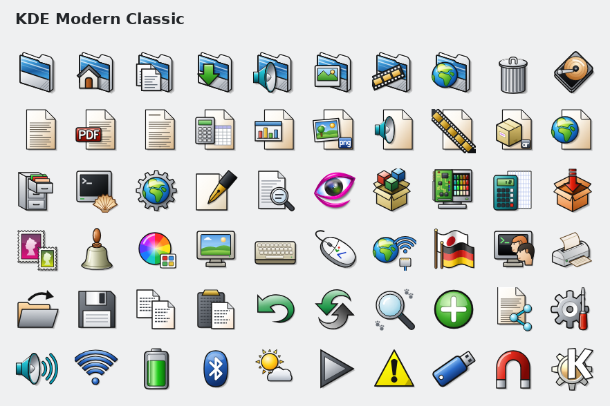

# KDE Modern Classic

A modern take on the KDE 2/3 "KDE Classic" icons: a complete SVG icon theme for KDE Plasma 6.

The classic designs are redrawn as clean vectors, some are reworked for today's desktop, and everything KDE 3 never
had (weather, modern tray states, Wayland and other newer settings) is drawn new in the same style: glossy colours,
top-left lighting, dark outlines and KDE 3's teal arrows.

- **3,182 icon names** from **1,237 drawings**, plus 536 versions tuned for 16 and 22 px
- Covers Plasma's desktop, panel and system tray, Dolphin, System Settings, Discover and the main KDE apps, so none
  of them fall back to Breeze
- Crisp at every size, and readable on light and dark colour schemes

## Install

**From the KDE Store:** System Settings > Colours & Themes > Icons > Get New…, search for "KDE Modern Classic".

**From a release download:** System Settings > Colours & Themes > Icons > Install from File, and pick the
`KDE-Modern-Classic-*.tar.gz`.

**From this repository:**

    git clone https://github.com/nzoomed/kde-modern-classic.git
    cd kde-modern-classic
    make install                 # for your user; or: sudo make install PREFIX=/usr

then choose "KDE Modern Classic" under System Settings > Colours & Themes > Icons.

When updating, remove the old version first (`make uninstall`, or delete `~/.local/share/icons/KDE-Modern-Classic`),
clear `~/.cache/icon-cache.kcache`, install the new one, then log out and back in.

### Optional add-ons

Add-ons are tiny themes that change a few icons and use KDE Modern Classic for everything else. Only one icon theme
can be active, so put all the icons you want to change in one add-on.

- **Generic Browser** (`make addon-generic-browser`): Firefox shows the theme's globe-in-a-window instead of its own
  logo. The theme itself never replaces Firefox's logo.
- **Your own:** [`addon-kit/`](addon-kit/README.md) builds an add-on from any icons you supply, for example an
  app's official logo you have the right to use.

## Missing or wrong icon?

Run the included checker to see which apps in your menu still use another theme's icon:

    bash ~/.local/share/icons/KDE-Modern-Classic/check-app-icons.sh

Then [open an icon request](../../issues/new?template=icon-request.yml) with the app's name and the icon name from
its `.desktop` file. For an icon that looks wrong, use the [bug report](../../issues/new?template=bug-report.yml).

Apps' brand logos (Firefox, GIMP, VLC …) are left as they are on purpose: the theme draws a picture of what a
program does, never a copy of someone else's logo.

## Building

Each icon is a small Python function that draws an SVG on a 64×64 canvas (`src/`). Building needs only Python 3,
with no extra packages:

    make build          # redraws KDE-Modern-Classic/ from src/
    make test           # checks for broken links, SVG problems Qt would show as black squares, and more
    make check-build    # confirms the committed theme is exactly what src/ draws
    make dist           # KDE-Modern-Classic-YYYYMMDD.tar.gz for the store

See [CONTRIBUTING.md](CONTRIBUTING.md) to add or change an icon, [docs/STYLE.md](docs/STYLE.md) for the drawing
rules and [docs/ROADMAP.md](docs/ROADMAP.md) for what's planned.

## How it was made

Every icon in this theme was drawn as SVG by an AI assistant (Claude, by Anthropic), working from the original KDE
Classic icons under the author's direction. Each icon was reviewed by eye against the originals and revised until
it was right; many went through several rounds. The theme's design decisions and final say on every icon are the
author's.

## Licence and credits

KDE Modern Classic is released under the GNU Lesser General Public License, version 3 or (at your option) any later
version (`LGPL-3.0-or-later`); see [COPYING.LESSER](COPYING.LESSER) and [COPYING](COPYING).

- Author: Shaun Belcher (design direction, review, maintenance). See [AUTHORS](KDE-Modern-Classic/AUTHORS).
- KDE Classic artwork: the KDE artists of the 2.x/3.x era, maintained by James Richard Tyrer. Free for any use,
  including copying, modification and redistribution ([LICENSE-KDE-Classic.txt](KDE-Modern-Classic/LICENSE-KDE-Classic.txt)).
- KDE logo (start-here, kmenu): from KDE_2_logo.svg, covered by the LGPL like KDE's own artwork. KDE, K Desktop
  Environment and the KDE Logo are trademarks of KDE e.V.

Bundling the theme in a distribution or a Global Theme? See "For distributions and theme bundles" in the
[theme's README](KDE-Modern-Classic/README.md).
